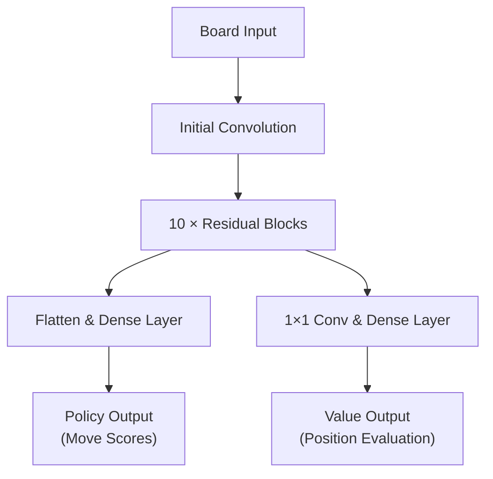

# FixMyElo

FixMyElo, ML Projects 2025-2026.

## Overview
FixMyElo is a policy-value CNN chess engine running MCTS, inspired by AlphaGo/Zero, recreated on a budget. It is strong enough to beat beginner to amateur players on around 800 MCTS sims per move, even [beating Stockfish18 at the lowest depth](model_win_against_stockfish.pgn). We used games from [lumbrasgigabase.com](https://lumbrasgigabase.com/) and [lichess.org](https://lichess.org/) to train our models.

## Architecture
The model architecture closely follows that of Google Deepmind's AlphaZero's. The model takes in as input the encoded board position, then outputs a policy (distribution of possible moves and how viable each is) and a value (static evaluation of the position).

## MCTS inference
During inference, the model does the following:
1. Create a game tree, with the current position at the root.
2. Calculate the Upper Confidence Bound score for each move.
3. Explore the move with the highest UCB score.
4. Return the move with the most visits made after the simulation budget is used up.

Note that our implementation followed the formula referenced in [this excellent blog](https://suragnair.github.io/posts/alphazero.html)

## Sample position evaluations

| | |
| :---: | :---: |
|  |  |
| | |
|  |  |

## TensorBoard logs
The tensorboard log for training can be viewed as follows:
1. Download the log file from [HERE](https://drive.google.com/drive/folders/1VC7vrFbBWn8G_twa3Cyot6SD9RK_KSxU?usp=sharing).
2. Download TensorBoard with `pip install tensorboard`
3. Launch the preview with `tensorboard --logdir 20260728-132218`

See the full development notes [HERE](https://docs.google.com/document/d/1r2DsHcfkksEIRd9lvSYco7LtyJas34p0d9OhHjWisBo/edit?tab=t.412b8dl60pdy#heading=h.gel5tpwcy3vn).

## Website Features
1. Play against the engine either as white or black 
3. Set the number of simulations to anything over 2 and less than 2000
4. Visualize the MCTS the engine performed in the tree below the board

Play against it [HERE](https://fme-frontend-795569892145.us-central1.run.app/)!
