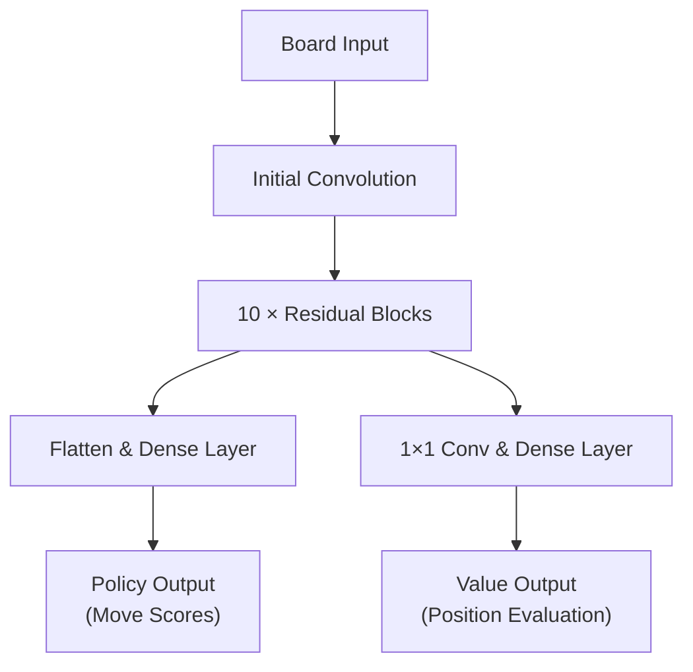

# FixMyElo

FixMyElo, ML Projects 2025-2026.

## Overview
FixMyElo is a policy-value CNN chess engine running MCTS, inspired by AlphaGo/Zero, recreated on a budget. It is strong enough to beat beginner to amateur players on around 800 MCTS sims per move, even [beating Stockfish18 at the lowest depth](model_win_against_stockfish.pgn).

## Architecture
The model architecture closely follows that of Google Deepmind's AlphaZero's.

## Sample position evaluations

## Features
1. Play against the engine either as white or black 
3. Set the number of simulations to anything over 2 and less than 2000
4. Visualize the MCTS the engine performed in the tree below the board

See the full development notes here: https://docs.google.com/document/d/1r2DsHcfkksEIRd9lvSYco7LtyJas34p0d9OhHjWisBo/edit?tab=t.0#heading=h.zftjrh5ga0lp

Play against it here: https://fme-frontend-795569892145.us-central1.run.app/
